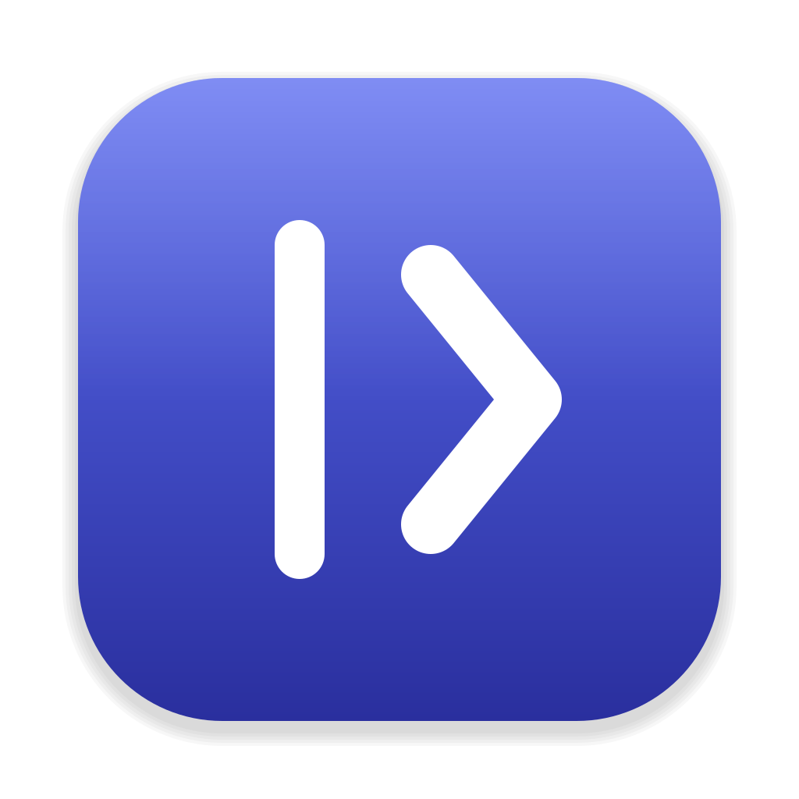
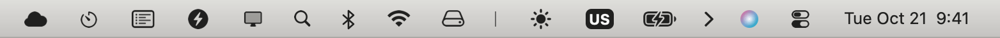

<div align="center">



# Hidebar

Hide menu-bar icons behind one divider. Open source, for macOS.

[](https://github.com/pod2metra/hidebar/actions/workflows/ci.yml)
[](https://github.com/pod2metra/hidebar/releases/latest)
[](LICENSE)


[Website](https://pod2metra.github.io/hidebar)

</div>

<!-- Capture docs/media/collapsed.png and docs/media/expanded.png (the menu bar with the section collapsed and expanded) before publishing. -->

| Collapsed | Expanded |
|---|---|
|  |  |

## Install

With Homebrew:

```bash
brew install --cask pod2metra/tap/hidebar
```

Or download the DMG from the [latest release](https://github.com/pod2metra/hidebar/releases/latest) and drag Hidebar to Applications.

Hidebar needs macOS 15 (Sequoia) or later.

## How to use

Hidebar puts one divider in the menu bar: a pipe (`|`) and an arrow to the right of it.

- **Collapse and expand.** Click the arrow. Everything left of the pipe is hidden; click again to bring it back. Hidebar always starts expanded.
- **Choose what is hidden.** Hold ⌘ and drag an icon (the system's own gesture) to the left of the pipe to hide it, or to the right to keep it visible. Keep the arrow right of the pipe: if it would be hidden along with the icons, Hidebar does not collapse.
- **Menu.** Right-click, Control-click or middle-click the pipe or the arrow for: Show Icon Images… (only while Screen Recording is off), How to Use Hidebar…, Quit Hidebar.
- **Overflow strip.** Icons right of the pipe that do not fit the bar, because they sit under the notch or the app menus, appear in a scrollable strip below the bar. Click one there to click the real icon.

## Permissions

Hidebar works with fewer features when a permission is missing; it never refuses to run.

| Permission | Why | Without it |
|---|---|---|
| Accessibility | Tells which app owns each icon and clicks icons from the overflow strip with synthetic ⌘-drag and mouse events. Requested at first launch. | Hiding with the divider still works; the strip lists icons but cannot click them |
| Screen Recording (optional) | Captures the images of icons for the strip. Asked only when you choose Show Icon Images… | The strip shows each app's name and icon instead of a snapshot |

macOS ties both grants to the app's code signature. Hidebar is not sandboxed, because a sandboxed app cannot click other apps' icons.

## Privacy

No telemetry and no network access. Hidebar stores only the positions of its own two menu-bar items. The icon snapshots are taken in memory for the strip and are not saved.

## Known limitations

- Clicking an icon in the strip posts synthetic mouse events. No new step starts after 10 seconds in total, and the cursor is put back afterwards. User input is never blocked.
- The Clock, Control Center and Siri items cannot be moved, so they cannot be clicked from the strip.
- On macOS 26 every icon's window is owned by Control Center, so icons can only be told apart through Accessibility. Without it they are listed but never clicked.
- A clicked icon returns to its place when its menu closes, or after about 10 seconds. While a menu is open the return is postponed, up to 120 seconds in all.
- A busy or frozen app slows icon discovery; Accessibility requests time out after 0.3 seconds per app.
- Sequoia asks again for Screen Recording from time to time.
- With ad-hoc signing macOS may forget the granted permissions after every rebuild.
- macOS 15 is the minimum target; run check 6.2 of the manual checklist ([docs/MANUAL_TEST.md](docs/MANUAL_TEST.md)) on it before relying on it.

## Build from source

Requires Xcode 27 (Swift 6.4).

```bash
git clone https://github.com/pod2metra/hidebar.git
cd hidebar
make check    # tests, 100% HidebarCore coverage, mutation score, adapter lint
make run      # Debug build signed with a local identity, then launched
```

`make package` builds an ad-hoc signed `build/Hidebar.dmg`. See [docs/XCODE_SETUP.md](docs/XCODE_SETUP.md) for the project layout and for keeping permissions stable between rebuilds, and [docs/MANUAL_TEST.md](docs/MANUAL_TEST.md) for the manual checklist.

## Contributing

Issues and pull requests are welcome. See [docs/ARCHITECTURE.md](docs/ARCHITECTURE.md) for the layers and the gates. Run `make check` before sending a change. New logic goes into `HidebarKit/Sources/HidebarCore` with tests; `HidebarSystem` and `App/` stay free of logic. Do not edit `Hidebar.xcodeproj/project.pbxproj` by hand.

## License

MIT, see [LICENSE](LICENSE).
